# EV-OptiGrid 2.0

**Deep Learning–Based EV Charging Demand Forecasting and Smart Charging Optimization**

EV-OptiGrid helps a driver answer two questions:

1. How much charging demand is expected at a site over the next 24 hours?

2. When should my car charge so it reaches my target battery percentage before I leave?

The application uses historical charging data to forecast demand, vehicle specifications to calculate energy needs, and an optimizer to choose charging hours. A virtual battery then follows the schedule so the user can check the result.

**Technology stack:** MongoDB, Express.js, React.js, Node.js, TensorFlow.js, Socket.IO, and Docker Compose.

## Quick start

Install **Node.js 22.12 or later** and start **MongoDB 7** locally. Open a terminal in the project folder containing `package.json` and run:

```sh

npm ci

npm run build

npm start

```

When the terminal shows `EV-OptiGrid available on port 3000`, open **http://localhost:3000**. Keep the terminal running while using the dashboard. The project includes trained model weights, so the first forecast works without retraining.

## Walkthrough with screenshots

The following example uses an **Abarth 500e Convertible**. The driver has **25% battery**, wants to reach **45%**, and plans to leave in **two hours**.

### 1. Forecast charging demand

Open **Planner**, choose a charging site, select **CNN–BiLSTM–Attention**, and click **Run forecast**. Leave **Origin** empty to use a historical example.

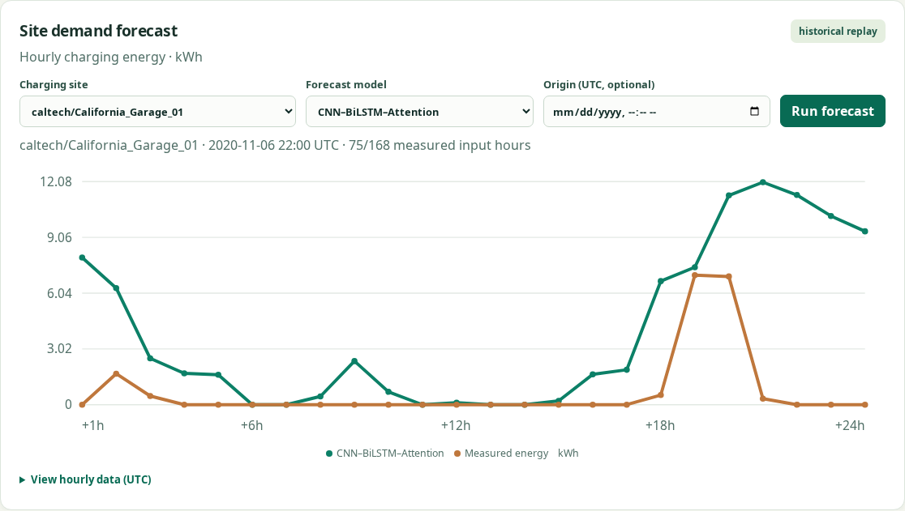

The model reads the previous **168 hours**, or seven days, and predicts the next **24 hourly energy values**. Each point represents the energy delivered by the whole charging site during one hour. The measured line shows what actually happened on that historical day.

### 2. Check the hourly predictions

Click **View hourly data (UTC)** below the chart.

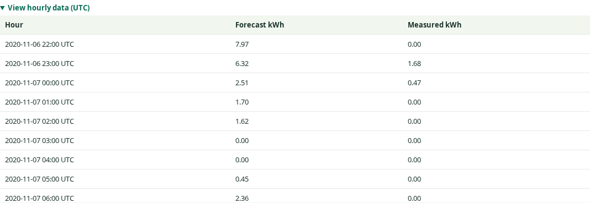

Each row shows the time, predicted energy, and measured energy in **kilowatt-hours (kWh)**. A dash means the historical measurement was unavailable.

### 3. Select the car and enter charging requirements

Choose **Abarth 500e Convertible** and enter these values:
| Input | Example value | Meaning |
|---|---:|---|
| Current SOC | 25% | How full the battery is now |
| Target SOC | 45% | How full the battery should be at departure |
| Hours to departure | 2 | Time available for charging |
| Charging efficiency | 0.90 | 90% of energy drawn from the charger reaches the battery |
| Charging mode | AC | Use the AC charger and onboard power limits |
| Charger limit | 11 kW | Maximum power available from the charger |
| Onboard AC limit | 11 kW | Assumed maximum AC power the car can accept |
| Site limit | 100 kW | Assumed capacity shared by the site and the planned charge |

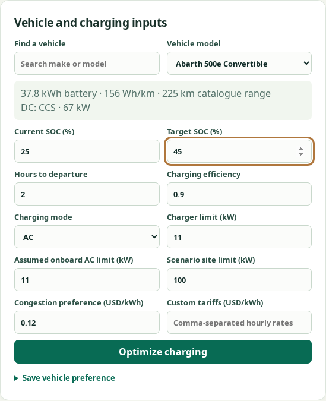

**SOC** means **state of charge**, or battery percentage. The selected car has a **37.8 kWh** battery. Raising it from 25% to 45% adds 20 percentage points, so the battery needs `37.8 × 0.20 = 7.56 kWh`. At 90% efficiency, the charger must supply `7.56 ÷ 0.90 = 8.40 kWh`.

### 4. Generate the charging schedule

Click **Optimize charging**.

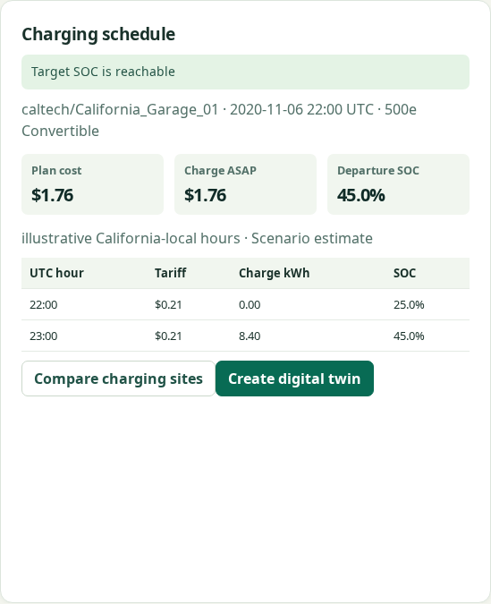

The planner assigns energy to individual hours. It considers electricity rates, predicted site demand, charging limits, and the departure deadline. Compare **Plan cost** with **Charge ASAP** to see how the recommended schedule compares with charging as early as possible.

If the target cannot be reached, the app shows the achievable battery percentage and the remaining energy shortfall.

### 5. Compare charging sites

Click **Compare charging sites** below the schedule.

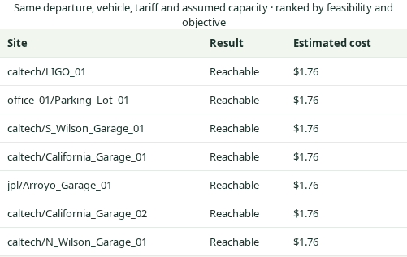

The app evaluates eligible sites using the same car, departure time, tariff, and capacity assumptions. Sites where the car can reach its target appear first. Among feasible plans, the ranking considers cost and the selected preference for avoiding congestion.

### 6. Start the EV digital twin

Click **Create digital twin**, then **Start simulation**.

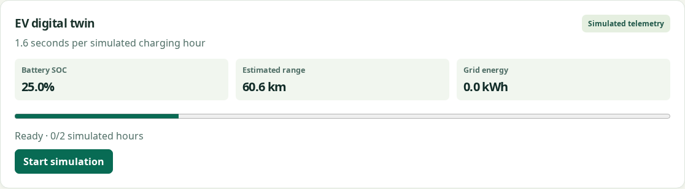

A digital twin is a software representation of the car’s battery. It starts at the chosen battery percentage and follows the saved schedule. Each simulation step represents one charging hour. Socket.IO updates the dashboard as the battery state changes.

### 7. Verify the energy delivered

After the simulation reaches departure, expand **Station meter receipts**.

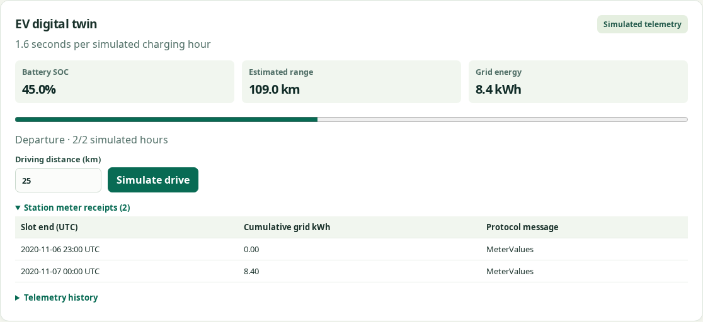

The virtual charger sends a meter reading through an OCPP gateway after each slot. The readings are **cumulative**. In this example, the final reading is **8.40 kWh** and the battery reaches **45%**. This matches the calculation in step 3.

### 8. Simulate a drive

After departure, enter **25 km** and click **Simulate drive**.

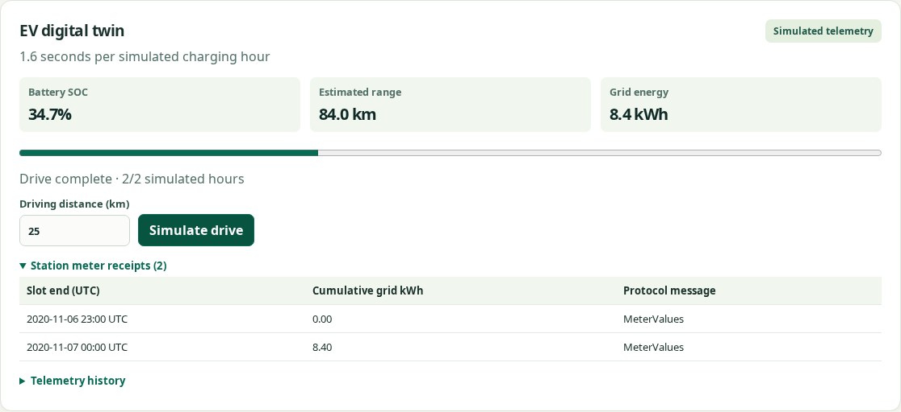

The catalogue gives this car an energy consumption of **156 Wh/km**. A 25 km drive uses `25 × 156 = 3,900 Wh`, or **3.90 kWh**. The dashboard updates the battery percentage and estimated remaining range.

### 9. Compare the trained models

Open **Model results**.

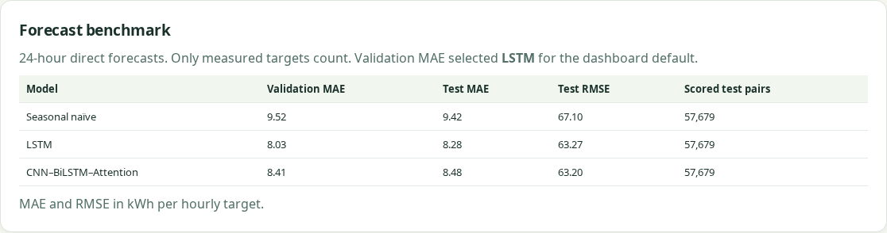

The benchmark compares each model’s forecast with actual measurements from dates held out for testing. **MAE** gives the average size of a prediction error. **RMSE** gives large errors more weight. Lower values are better for both metrics.

### 10. Inspect the training curves

Scroll to **Training and validation loss**.

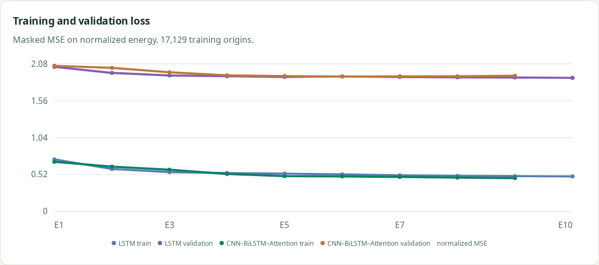

An **epoch** is one pass through the training examples. The curves show how the error changed as the networks learned. The saved LSTM checkpoint comes from epoch **10**. The hybrid trained for **9** epochs and its best checkpoint came from epoch **6**.

### 11. Check the dataset coverage

Scroll to **Dataset coverage**.

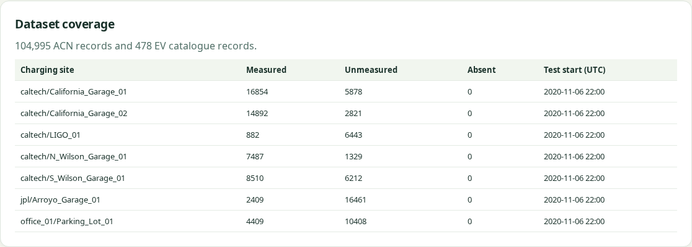

This table shows how many hours had energy measurements at each site. A measured zero means zero energy was recorded. An unmeasured hour means the actual energy is unknown. Only measured targets contribute to the benchmark scores.

### 12. Save a preferred vehicle

Return to **Planner**, expand **Save vehicle preference**, enter a profile name, and click **Save profile**.


The application remembers the selected vehicle for the current browser workspace.

### 13. Reopen a saved charging plan

Open **Saved plans** and click the vehicle row.

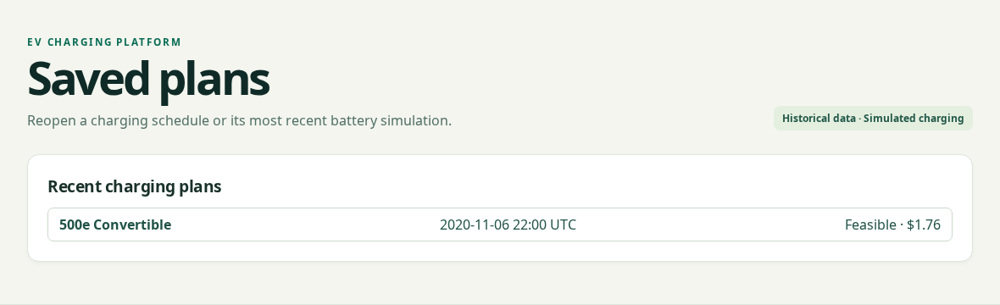

MongoDB restores the saved forecast, charging schedule, and latest simulation state. If the car completed a simulated drive, the reopened session shows the updated battery state.

## Datasets

### ACN hourly charging data

The charging measurements come from the **Caltech Adaptive Charging Network (ACN)**. The project uses session files from the **ACN-Data-Static** archive. The upstream processing summary reports that **85,870 charging-session files** were processed into **104,995 hourly records** across **seven charging sites** from **2018 to 2020**.

- [Original dataset — Caltech ACN-Data](https://ev.caltech.edu/dataset.html)

- [Charging-session archive — ACN-Data-Static on GitHub](https://github.com/tongxin-li/ACN-Data-Static)

- [Processed hourly CSV used in this project](data/acn_hourly_load.csv)

- [Preprocessing summary](data/acn_data_quality.json)

One row represents **one hour at one charging site**.
| Column | Meaning |
|---|---|
| `timestamp_utc` | Start of the observation hour in UTC |
| `site_id` | Charging site or garage |
| `energy_kwh` | Estimated energy delivered across the site during that hour, in kilowatt-hours |
| `active_sessions` | Number of charging sessions that overlapped the hour |
| `observed_energy` | `1` if an energy measurement was available, or `0` if it was missing |

For example, at `caltech/California_Garage_01` on **1 May 2018 at 01:00 UTC**, nine charging sessions overlapped the hour. Together, they accounted for **18.49 kWh** of recorded energy.

Of the 104,995 hourly records, **55,443 had measured energy**. The `observed_energy` flag distinguishes a measured zero from a missing reading. During training and evaluation, only measured values contribute to the prediction error. The forecasting models use the previous **168 hours (7 days)** to predict energy demand for the **next 24 hours**.

### EV specifications

The vehicle catalogue comes from **Urvish Ahir’s Electric Vehicle Specs Dataset (2025)**. It contains **478 vehicle records and 22 columns**. Each row describes one vehicle model or variant and includes a `source_url` linking to its specification page on **EV Database**.

- [Original dataset — Electric Vehicle Specs Dataset (2025) on Kaggle](https://www.kaggle.com/datasets/urvishahir/electric-vehicle-specifications-dataset-2025)

- [Author’s CSV on Hugging Face](https://huggingface.co/datasets/UrvishAhir1/Electric-Vehicle-Specs-Dataset-2025/blob/main/electric_vehicles_spec_2025.csv)

- [Vehicle specifications CSV used in this project](data/ev_specifications.csv)

The application uses **battery capacity** to calculate how much energy the car needs, **energy consumption** to simulate driving, and **peak DC charging power and connector type** to check charging compatibility. The dashboard also displays the vehicle’s published range.

For example, the **Abarth 500e Convertible** has a **37.8 kWh** battery. Raising its charge from **25% to 45%** adds **7.56 kWh** to the battery. [View this vehicle on EV Database](https://ev-database.org/car/1904/Abarth-500e-Convertible).

### How the datasets work together

The datasets come together when the driver creates a charging plan. **ACN data helps forecast demand at the selected site. EV specifications determine the selected car’s energy needs and charging limits.** The planner combines these inputs with electricity prices and the departure deadline to choose charging hours. The driver selects the vehicle separately because the historical ACN records do not identify its catalogue model.

## Model training and results

Two neural networks were trained with **TensorFlow.js** and compared with a weekly seasonal baseline.
| Model | How it works | Test MAE (kWh) | Test RMSE (kWh) |
|---|---|---:|---:|
| Weekly seasonal baseline | Uses the same hour from the previous week, with a training-data fallback for missing readings | 9.424 | 67.098 |
| LSTM | Learns patterns across the historical sequence | **8.276** | 63.265 |
| CNN–BiLSTM–Attention | Finds short patterns, reads the historical sequence in both directions, and weights relevant parts before predicting | 8.481 | **63.199** |

All seven sites use common chronological cutoffs. Training uses earlier dates, and the final test uses later dates. Future session counts are excluded from model inputs.

The **LSTM** is the dashboard default because it had the lowest validation MAE. On the final test, it also had the lowest MAE. The **CNN–BiLSTM–Attention** model had the lowest test RMSE.

### Training evidence
| File | What it shows |
|---|---|
| [Training console log](docs/training-evidence/training-console.log) | Output from the executed training run |
| [Epoch losses](docs/training-evidence/epoch-losses.csv) | Training and validation loss for each epoch |
| [Held-out prediction example](docs/training-evidence/holdout-example.csv) | Actual energy and all three predictions for the same 24 hours |
| [Model evaluation report](docs/MODEL_EVALUATION.md) | Data splits, model settings, results, and interpretation |
| [Saved model artifacts](ml/artifacts/) | Trained weights, model definitions, and evaluation metrics |

## Project structure
| Directory | Purpose |
|---|---|
| `frontend/` | React dashboard, forms, charts, and live session view |
| `backend/` | Express APIs, MongoDB access, and Socket.IO updates |
| `ml/` | Data preparation, TensorFlow.js training, evaluation, and inference |
| `optimization/` | Charging constraints and hourly schedule calculation |
| `simulator/` | Virtual battery, driving simulation, and charger communication |
| `data/` | ACN hourly data, EV specifications, and upstream quality summary |
| `tests/` | Automated domain, API, database, socket, and browser tests |
| `docs/` | Screenshots, system design, dataset documentation, and training evidence |

## Useful commands

Run these commands from the project root.
| Command | What it does |
|---|---|
| `npm run build` | Builds the React dashboard |
| `npm start` | Starts the application and loads the saved models |
| `npm run validate` | Checks the datasets and writes the data-quality report |
| `npm run evaluate` | Recomputes metrics using the saved model weights |
| `npm run train` | Retrains the networks and replaces the model artifacts |
| `npm test` | Runs automated Node.js tests; the database integration test requires `TEST_MONGODB_URI` |
| `npm run test:e2e` | Runs the Playwright browser workflow |
| `npm run demo:charger` | Runs the standalone virtual charger communication example |

### Run all tests on Windows

With MongoDB running, enter the following in PowerShell:

```powershell

$env:TEST_MONGODB_URI = "mongodb://127.0.0.1:27017"

npm test

npm run build

npx playwright install chromium

npm run test:e2e

```

### Run with Docker Compose

With Docker Engine and the Compose plugin installed:

```sh

docker compose up --build -d

docker compose ps

```

Open **http://localhost:3000**. MongoDB stores records in a named volume. To stop the services while keeping the saved data:

```sh

docker compose down

```

## Verification and scope

**Seven Node.js tests and one Chromium browser test passed.** The tests covered model inference, optimization, MongoDB persistence, Socket.IO updates, site comparison, virtual meter receipts, driving simulation, and reopening a saved plan.

Forecast metrics come from historical ACN measurements. Tariffs and site capacity are scenario inputs. Battery behavior, driving, and charger readings are simulated. Physical charger interoperability, actual electricity-bill savings, and Docker container startup remain unverified.

## Documentation

- [Project overview](docs/PROJECT_OVERVIEW.md)

- [High-level design](docs/HLD.md)

- [Low-level design](docs/LLD.md)

- [Dataset documentation](docs/DATASET.md)

- [Model evaluation](docs/MODEL_EVALUATION.md)

- [Training evidence](docs/training-evidence/README.md)

- [Verification report](docs/VERIFICATION.md)
