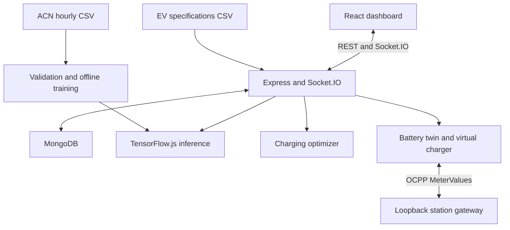

# High-level design

## Purpose

EV-OptiGrid helps an EV owner examine historical site demand, calculate a feasible schedule for the selected vehicle, and simulate the schedule through departure. The model predicts hourly background charging energy at one ACN location. The planner allocates incremental grid energy for one EV under a user-specified site limit.

## Components

| Component | Responsibility |
| --- | --- |
| React dashboard | Site and vehicle selection, forecast and model charts, scenario inputs, schedule and live twin views |
| Express API | Validate requests, serve catalogue and evidence, coordinate inference, scheduling, and persistence |
| TensorFlow.js | Offline training, rolling-origin benchmark, direct 24-hour inference from prebuilt weights |
| Optimization | Allocate a single vehicle's divisible grid energy by increasing marginal cost under hourly capacity constraints |
| Digital twin | Simulate charge and drive energy, retain state and send live telemetry updates |
| MongoDB | Hold workspace profiles, saved forecasts, plans, and versioned twins |
| OCPP loopback demonstration | Show three OCPP 1.6 JSON exchanges between two virtual endpoints |

## Main workflows

### Forecast and plan

The dashboard sends a site, a historical origin and a model choice. The API builds the prior 168 hours of model features. Inference returns 24 hourly site-load values. The API persists the result with measured replay values where available. A planning request brings that saved forecast together with the chosen catalogue vehicle and the driver's departure and SOC requirements. Express saves the computed schedule and returns an achievable SOC and any shortfall.

### Simulation

A twin starts with the plan's initial battery state. The server processes one schedule slot every 1.6 seconds for each active simulation in normal operation. Each successful MongoDB update increments the twin version and publishes the result to the workspace Socket.IO room. The dashboard retrieves the latest saved version when reconnecting. After the final slot, the user can simulate a drive and see the energy/range reduction.

### Training

The offline pipeline validates both data files, constructs synchronized chronological partitions for ACN, and fits transforms only from training observations. The hybrid and recurrent baseline use past features and return 24 predictions directly. The evaluator compares both models with a weekly seasonal baseline on the same measured hour-origin pairs.

## Deployment and boundaries

Compose runs one Node.js service and one MongoDB service. It serves the compiled dashboard, API and sockets on the same origin. The app is exposed on the developer's loopback interface and MongoDB has an internal volume. The application assumes trusted local use. There is no public account system or role management. For operational use, a deployment would need authenticated identities, charger provisioning, monitored ingest, calibration against live telemetry, tariff agreements, and testing with authorized hardware.

Site capacity and tariff inputs are scenario variables. The battery twin has an energy-balance model and constant energy efficiency. Physical charger response, queue delays, live utility rates, battery health, travel routing and real charging savings are outside the measured scope.
